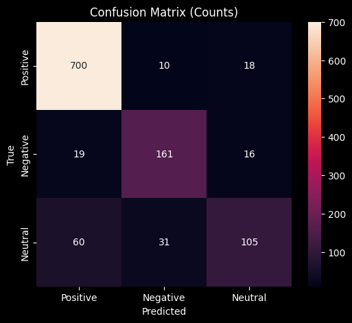
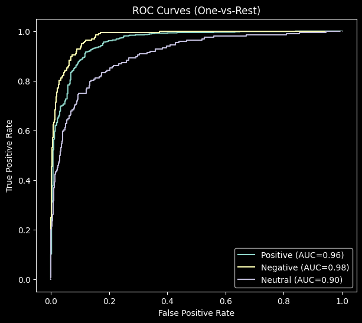
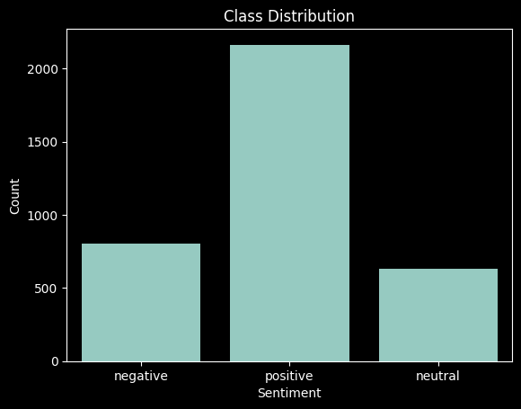
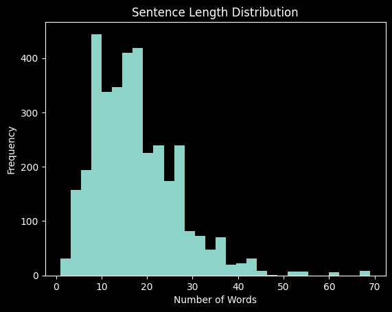
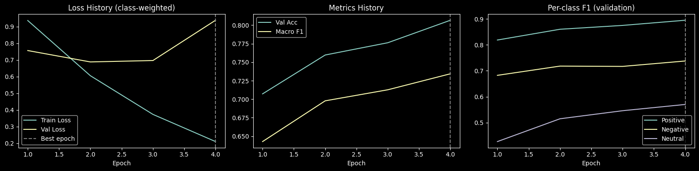

# 🍽️ Aspect-Based Sentiment Analysis


Fine-grained sentiment classification on **SemEval-2014 Task 4 (Restaurants)**: given a review sentence and a target aspect term, predict whether the sentiment *toward that aspect* is **positive**, **negative** or **neutral**.

> "The food was great, but the waiter's attitude ruined the evening."
> → `food`: **positive**, `waiter`: **negative**

A single sentence can carry opposite opinions about different aspects, so a sentence-level classifier is not enough. This project frames the task as **sentence-pair classification** with a fine-tuned transformer and tunes it systematically with Ray Tune.

## ✨ Highlights

- **Test accuracy 86.25%** and **Macro-F1 0.7883** on the official SemEval-2014 gold test set (1,120 aspect samples).
- **Leakage-free validation**: samples are split with `StratifiedGroupKFold`, grouped by sentence, so no sentence appears in both train and validation.
- **Systematic hyperparameter search**: 20 Ray Tune trials with ASHA early stopping over two backbones (RoBERTa-base, DeBERTa-v3-base), learning rate, batch size and weight decay. All 20 trials completed without errors.
- **Imbalance-aware training**: inverse-frequency class weights in the loss, and model selection by validation Macro-F1.
- **Stable training**: gradient clipping, linear warm-up and decay, non-finite loss and gradient guards.
- **Thorough evaluation**: precision, recall, F1, Macro-F1, Cohen's kappa, MCC, confusion matrices and one-vs-rest ROC curves (AUC 0.96 / 0.98 / 0.90 for positive / negative / neutral).
- **Robustness checks**: 20 hand-written challenge sentences (contrast, negation, conditionals, out-of-domain aspects) and 20 minimal-edit adversarial pairs.

## 🗺️ Project phases

| Phase | What it covers | Key output |
|---|---|---|
| **1. Data and EDA** | Parse the SemEval XML into one sample per (sentence, aspect), analyse class balance, sentence length and vocabulary. | 3,602 training samples, class distribution, length histogram, word clouds |
| **2. Model and training** | Sentence-pair input, RoBERTa classifier, class-weighted loss, 20-trial Ray Tune search, retraining on all data. | Best config (RoBERTa-base, lr ≈ 3.6e-5, batch 16), saved model |
| **3. Evaluation** | One-time evaluation on the gold test set, confusion matrices, ROC, error analysis. | **Macro-F1 0.7883**, accuracy 86.25% |
| **4. Robustness** | 20 challenge sentences and 20 minimal-edit pairs. | Prediction unchanged in 17 of 20 pairs |

## 📊 Results

Final model: RoBERTa-base, trained on train + validation, evaluated once on the gold test set.

| Class | Precision | Recall | F1 | Support |
|---|---|---|---|---|
| Positive | 0.8986 | 0.9615 | 0.9290 | 728 |
| Negative | 0.7970 | 0.8214 | 0.8090 | 196 |
| Neutral | 0.7554 | 0.5357 | 0.6269 | 196 |
| **Macro avg** | **0.8170** | **0.7729** | **0.7883** | 1,120 |
| Weighted avg | 0.8558 | 0.8625 | 0.8551 | 1,120 |

Accuracy 0.8625, Cohen's kappa 0.7220, MCC 0.7263.

<p align="center">
  
  
</p>

Positive and negative aspects are detected reliably. Neutral is the hardest class (descriptive sentences with no opinion words are often read as positive), which makes it the clearest target for future work.

## 🧠 Method

| Step | Details |
|---|---|
| Data | SemEval-2014 Task 4, Restaurants. One training sample per `(sentence, aspect term)`; `conflict` labels removed. 3,602 training samples, 1,120 test samples. |
| Input | `tokenizer(sentence, aspect)` → `<s> sentence </s></s> aspect </s>`, max length 128. |
| Model | `roberta-base` with a freshly initialised 3-class classification head. |
| Loss | Cross-entropy with inverse-frequency class weights `N / (3 · n_c)`. |
| Optimiser | AdamW, linear schedule with 10% warm-up, gradient clipping at 1.0. FP32. |
| Split | `StratifiedGroupKFold(5)`, first fold, grouped by sentence → 2,878 train / 724 validation. |
| Search | 20 Ray Tune trials, ASHA scheduler, metric = validation Macro-F1, 4 epochs each. |
| Search space | model ∈ {roberta-base, deberta-v3-base}; lr ∈ log-uniform[1e-5, 5e-5]; batch size ∈ {16, 32}; weight decay ∈ {0.01, 0.1}. |
| Final training | Best configuration retrained for 4 epochs on all 3,602 samples. |

**Selected configuration:** `roberta-base`, learning rate ≈ 3.6e-5, batch size 16, weight decay 0.01, 4 epochs (validation Macro-F1 0.7343).

**Compute:** Kaggle notebook, 2 × NVIDIA T4 GPUs (each trial used one GPU).

## 🔍 Data analysis

<p align="center">
  
  
</p>

- Training set: 60.1% positive, 22.3% negative, 17.6% neutral.
- Most sentences have 5 to 30 words, so a 128-token limit never truncates meaningful content.
- Word clouds per polarity: [positive](assets/wordcloud_positive.png), [negative](assets/wordcloud_negative.png), [neutral](assets/wordcloud_neutral.png).

## 📈 Training behaviour

<p align="center">
  
</p>

Validation accuracy, Macro-F1 and every per-class F1 improve across all four epochs for the selected trial.

## 🛡️ Robustness

- **Challenge set (20 sentences):** the model handles most "X, but Y" contrast sentences and generalises to aspects outside the usual food/service vocabulary (for example `AC`, `app`, `seal`, `delivery`). Conditional phrases ("unless you order…") and genuinely mixed opinions are the main difficulty.
- **Minimal-edit pairs (20 pairs):** predictions stayed the same in 17 of 20 pairs, i.e. the model is stable under small wording changes in most cases.

Full details and discussion are in the project report.

## 📁 Repository structure

```
.
├── aspect_based_sentiment_analysis.ipynb
├── assets/
├── data/
│   ├── Restaurants_Test_Data_phaseB.xml
│   ├── Restaurants_Test_Gold.xml
│   └── Restaurants_Train_v2.xml
├── evaluation/
│   ├── comparison_pairs.json
│   └── difficult_cases.json
├── ABSA Project Report.pdf
├── description.md
├── LICENSE
└── README.md
```

## 🚀 Getting started

### 1. Install

```bash
pip install torch transformers "ray[tune]" scikit-learn pandas numpy matplotlib seaborn wordcloud
```

A CUDA GPU is strongly recommended (the original run used Kaggle's 2 × T4).

### 2. Get the data

Download the SemEval-2014 Task 4 Restaurants files and place them in a `data/` folder:

- `Restaurants_Train_v2.xml`
- `Restaurants_Test_Gold.xml`

Then update the paths at the top of the notebook (they currently point to Kaggle input folders).

### 3. Run

Open `aspect_based_sentiment_analysis.ipynb` and run the cells in order:

1. **Phase 1**: parsing, class distribution, length histogram, word clouds.
2. **Phase 2**: dataset class, Ray Tune search, retraining of the best configuration, model saving.
3. **Phase 3**: test-set evaluation, confusion matrices, ROC, error analysis.
4. **Phase 4**: challenge sentences and adversarial pairs (requires `difficult_cases.json` and `comparison_pairs.json`).

## 🔭 Ideas for further improvement

- Stronger handling of the neutral class (larger neutral weight, focal loss, or targeted augmentation).
- Marking the aspect span inside the sentence with special tokens to make the model more aspect-aware.
- Multi-seed runs or cross-validated tuning to reduce selection noise, and ensembling the top configurations.
- Evaluation on the Laptop domain and on aspect-category data.

## 👥 Team and contributions

This project began as a university team project. The original team members are:

- [Amir Mohammad Sharbati](https://github.com/AmirMohammad-Sharbati)
- [Seyed Mohammadreza Javadi](https://github.com/JavadiSM)
- [Alireza Elmifard](https://github.com/aref1010)

This repository is a continuation maintained by **[Amir Mohammad Sharbati](https://github.com/AmirMohammad-Sharbati)**, who contributed substantially to the original work and afterwards extended it: a leakage-free grouped split, Ray Tune search across two backbones, class-weighted training, numerical-stability guards, retraining on the full data, a broader evaluation suite and the robustness experiments.

## 📝 License

This project is licensed under the [MIT License](LICENSE). Datasets used are publicly available and are subject to their respective licenses.